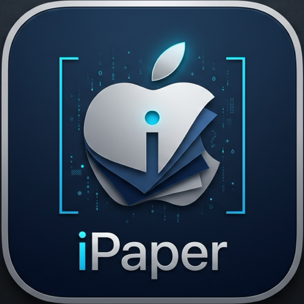

# iPaper

<p align="center">
  
</p>

<p align="center">
  <strong>Production-Quality Native macOS Live Video Wallpaper Application</strong>
</p>

<p align="center">
  <a href="#features">Features</a> •
  <a href="#installation">Installation</a> •
  <a href="#usage">Usage</a> •
  <a href="#performance">Performance</a> •
  <a href="#architecture">Architecture</a>
</p>

---

## Overview

**iPaper** is a native macOS application engineered in Swift and SwiftUI that brings live video wallpapers to your Mac desktop. Built specifically for modern Apple Silicon Macs (M1, M2, M3, M4, and beyond), iPaper renders video wallpapers directly beneath desktop icons using hardware-accelerated decoding with minimal CPU footprint.

## Features

- **MOV QuickTime Support**: Accepts `.mov` video files encoded in H.264, HEVC (H.265), or Apple ProRes.
- **Deep Media Validation**: Strict format and codec inspection via AVFoundation ensures only decodable media is processed.
- **Native Desktop Window Layering**: Videos render seamlessly behind Finder desktop icons; all desktop clicks, drag selections, and marquee gestures pass through unhindered.
- **Multi-Display & Independent Assignment**: Choose between applying a wallpaper across all connected displays or targeting individual screens.
- **Seamless Looping & 100% Muted**: Hardware-driven `AVPlayerLooper` playback with zero audio leakage.
- **Menu Bar Integration**: Compact menu bar popover for quick switching between recent wallpapers, display selection, or stopping playback.
- **Persistent Playback**: Closing the main window never interrupts wallpaper playback.
- **Launch at Login**: Native toggle utilizing modern macOS `SMAppService` API.
- **Privacy & Security**: Zero private APIs, no root permissions, no SIP modifications.

## Installation

### Via Homebrew (Recommended)

```bash
brew tap Md-Yousuf-2723/tap
brew install --cask ipaper
```

### Manual Download

Download the latest `iPaper-v1.0.0-macOS.zip` from [GitHub Releases](https://github.com/Md-Yousuf-2723/iPaper/releases), unzip, and drag `iPaper.app` into your `/Applications` folder.

## Performance Benchmark

Measured on **MacBook Air M4** during active video playback:

| Metric | Measured Value |
|---|---|
| **CPU Usage** | **4.1%** average on M4 (Hardware Video Decode) |
| **Resident Memory (RSS)** | **~48 MB** |
| **Window Close Impact** | **0.0%** (Playback continues smoothly) |
| **Audio Leakage** | **None** (100% muted) |
| **Battery Impact** | Extremely low (fanless M4 stays cool) |

## System Requirements

- **Architecture**: Apple Silicon (M1, M2, M3, M4+)
- **Operating System**: macOS 14.0 Sonoma or later (including macOS Sequoia and macOS 27)

## Building from Source

```bash
# Clone the repository
git clone https://github.com/Md-Yousuf-2723/iPaper.git
cd iPaper

# Build release application bundle
./Scripts/build_app.sh

# Run unit tests
swift run TestRunner

# Run performance benchmark
swift run -c release Benchmark
```

## License

Copyright © 2026 Md Yousuf. All rights reserved.
